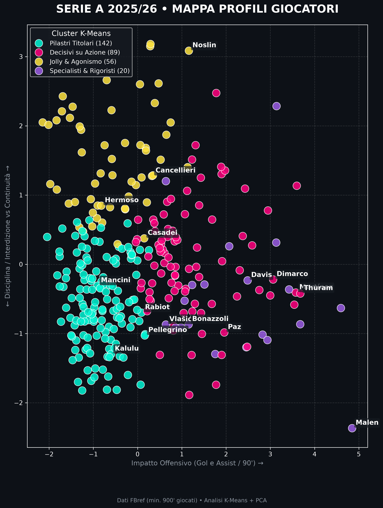
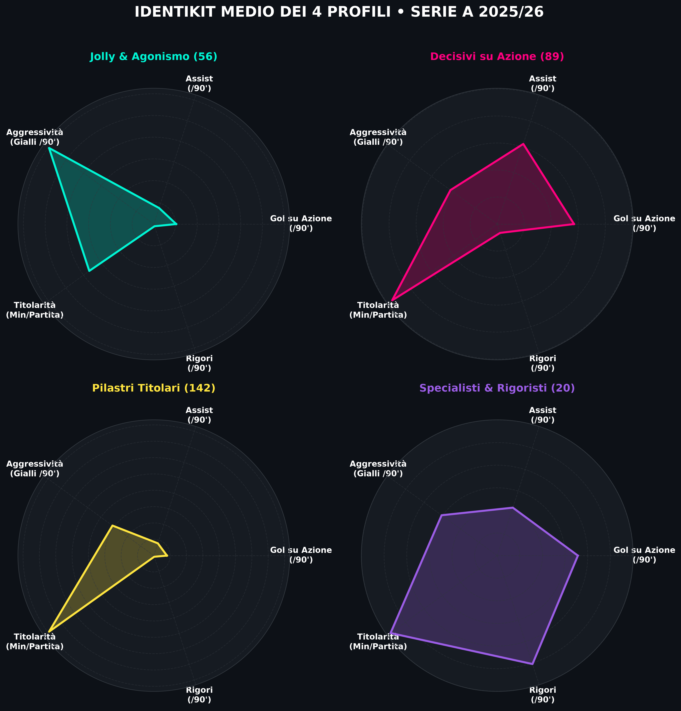

# Serie A 2025/26 — K-Means Player Profiling & Tactical Clustering

Analisi di clustering non supervisionato e riduzione dimensionale (**K-Means + PCA**) sui **307 giocatori** più impiegati della Serie A 2025/26 (soglia minima 900 minuti giocati, portieri esclusi), sviluppata in Python con `scikit-learn`, `pandas` e `seaborn`.

## Obiettivi dell'Analisi

* **Superamento dei Ruoli Nominali:** Classificare i calciatori in base al contributo reale espresso ogni 90 minuti (`G-PK`, `Ast`, `CrdY`, `PKatt`, `Min/MP`), indipendentemente dal ruolo sulla carta.
* **Dimensionality Reduction (PCA):** Comprimere 5 metriche normalizzate (`StandardScaler`) su due componenti principali per mappare visivamente le distanze tattiche tra profili.
* **Identikit Multi-Variabile:** Confrontare le firme statistiche medie dei 4 cluster tramite Radar Chart normalizzati (`MinMaxScaler`).

## Visualizzazioni & Analisi Tattica

### 1. Mappa degli Stili di Gioco (PCA 2D Scatter Plot)


### 2. Identikit Medio dei 4 Profili (Radar Chart)


## Business & Analytical Insights

* **Jolly & Agonismo (56 giocatori):** Giocatori ad altissima intensità agonistica e frequenza di cartellini per 90 minuti, spesso impiegati a gara in corso o in rotazione (es. *Casadei, Hermoso, Noslin*).
* **Decisivi su Azione (89 giocatori):** Profili ad alto impatto offensivo su azione manovrata senza dipendenza dai calci di rigore (es. *Dimarco, Thuram, Lautaro Martínez, Nico Paz*).
* **Pilastri Titolari (142 giocatori):** La spina dorsale insostituibile delle squadre, caratterizzata dal massimo minutaggio medio per presenza e stabilità posizionale (es. *Kalulu, Rabiot, Mancini, Cambiaso*).
* **Specialisti & Rigoristi (20 giocatori):** Riferimenti offensivi primari con responsabilità dal dischetto e massimo peso specifico nella finalizzazione (es. *Malen, Vlašić, Berardi, Davis*).

## Metodologia Statistica

1. **Data Cleaning & Filtering:** Estrazione dei dati stagionali da FBref, esclusione dei portieri e filtro a $\ge 900$ minuti per eliminare la varianza dei campioni ridotti.
2. **Feature Scaling:** Standardizzazione Z-score ($z = \frac{x - \mu}{\sigma}$) per evitare che scale diverse (es. minuti per partita vs gol per 90') distorcano le distanze euclidee del K-Means.
3. **Clustering & Proiezione:** Partizionamento con `KMeans(n_clusters=4, init='k-means++')` e proiezione ortogonale tramite `PCA(n_components=2)`.

## Come eseguire lo script

```bash
python3 -m venv .venv
source .venv/bin/activate
pip install -r requirements.txt
python analisi.py

